# OrbiTouch ATS — System Architecture

## 1. Architectural Principles

OrbiTouch ATS is engineered specifically for **OrbiTouch HR & Recruitment Consultants (Orbitouch Outsourcing Private Limited)** to run reliably on **Hostinger Premium Web Hosting** (1 CPU Core, 2048 MB RAM, 20 GB NVMe storage, 40 PHP workers, 80 max processes) while maintaining clean separation of concerns so it can scale seamlessly to a VPS or cloud cluster in the future.

### Key Constraints & Solutions
1. **No Permanent Background Daemons Required:** Queue processing uses Laravel's database queue driver executed via a bounded, non-overlapping cron entry (`php artisan queue:work --stop-when-empty --max-time=50`) every minute.
2. **No Production Node.js Runtime Required:** Frontend assets (Tailwind CSS, Alpine.js, interactive charts) are pre-compiled via Vite into static, fingerprinted assets under `public/build`.
3. **20 GB NVMe Storage Protection:**
   - Candidate resumes, job descriptions, agreements, and offer letters are stored in Laravel's private local disk (`storage/app/private/...`) outside `public/`.
   - SHA-256 checksum deduplication prevents storing identical resume binaries repeatedly.
   - Real-time storage tracking enforces configurable 70%, 85%, and 95% threshold alerts and blocks uploads before disk exhaustion.
   - Abstracted `StorageService` supports drop-in switching to S3-compatible object storage.
4. **Low Memory & 1-Core CPU Footprint:**
   - Strict eager-loading (`with()`, `withCount()`) prevents N+1 queries.
   - Composite indexes on candidate phone/email normalization, application stage, job status, and recruiter assignments ensure sub-100ms query execution.
   - Server-side pagination (25/50 items per page) and debounced search (`300ms`).

---

## 2. Layered Application Structure

```text
app/
├── Console/Commands/         # Scheduled cron tasks (Backups, Storage Audit, Reminders, Overdue Tasks)
├── Enums/                    # Strongly-typed domain enums (JobStatus, PipelineStage, CallOutcome, etc.)
├── Http/
│   ├── Controllers/          # Web, Document Download, Export, and Client Portal controllers
│   ├── Middleware/           # Role verification, Client Tenant Isolation, 2FA Check, Active Account Check
│   └── Requests/             # Server-side FormRequest validation classes
├── Models/                   # 40+ Eloquent models with relationships, scopes, and audit observers
├── Policies/                 # Granular authorization policies enforced on all models
├── Services/
│   ├── AuditService.php              # Immutable audit & activity trail recorder
│   ├── BackupService.php             # Encrypted DB & private document backup/restore engine
│   ├── CandidateDuplicateService.php # Phone, email, and SHA-256 resume checksum duplicate engine
│   ├── DashboardAnalyticsService.php # Documented, single-pass SQL metric aggregations
│   ├── ExportImportService.php       # Formula-safe CSV/Excel import & export batch processor
│   ├── PipelineService.php           # Transactional stage progression, validation & auto-tasks
│   ├── StorageManagementService.php  # Private file vault, quota monitor & checksum service
│   └── VacancyClosureService.php     # Atomic vacancy counter & replacement opening service
```

---

## 3. Data Flow across the Recruitment Lifecycle

```mermaid
flowchart LR
    A["Client Requirement"] --> B["Job Description & Screening Setup"]
    B --> C["Recruiter Assignment & Targets"]
    C --> D["Candidate Sourcing & Dedup"]
    D --> E["Calling & Screening Checklist"]
    E --> F["Client Profile Submission Snapshot"]
    F --> G["Client Portal Review & Shortlist"]
    G --> H["Unlimited Interview Rounds (1..N)"]
    H --> I["Final Selection & Offer Management"]
    I --> J["Candidate Joining & Vacancy Update"]
    J --> K["Post-Joining Check-ins & Placement Closure"]
```



---

## 4. Security & Multi-Tenant Client Isolation

- **Internal Staff Scope:**
  - `Super Admin`: Full visibility across all clients, teams, jobs, candidates, settings, backups, and audit logs.
  - `Manager`: Visibility across assigned teams, clients, jobs, and operational analytics.
  - `Team Leader`: Visibility and workload distribution across their team's jobs, recruiters, and submissions.
  - `Recruiter`: Scoped to assigned job requirements and candidates they source or manage, with duplicate-effort indicators when a peer recruiter is active on a candidate.
- **External Client Scope (`ClientIsolationMiddleware` & Policies):**
  - Client HR users are bound to `client_id` on their `User` record.
  - Every query in the Client Portal is strictly scoped by `WHERE client_id = auth()->user()->client_id`.
  - Internal notes (`is_client_visible = false`), recruiter margins, placement fees, internal call logs, and unsubmitted candidates are never accessible to client users.
  - Document downloads (`DocumentController`) verify authorization policy and tenant ownership before streaming private files with `Content-Disposition` headers.
