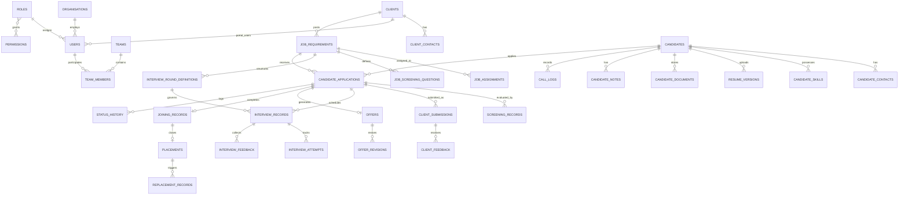

# OrbiTouch ATS — Relational Database Architecture & Schema

## 1. Entity-Relationship Diagram (ERD)

---

## 2. Complete Table Inventory (44 Tables)

1. **`organisations`**: Legal company (`Orbitouch Outsourcing Private Limited`), brand name (`OrbiTouch HR & Recruitment Consultants`), default timezone (`Asia/Kolkata`), default currency (`INR`), working schedule (`Mon-Sat 10:00-18:30`).
2. **`roles`**: `super_admin`, `manager`, `team_leader`, `recruiter`, `client`.
3. **`permissions`**: Granular permission keys (`clients.manage`, `jobs.assign`, `candidates.merge`, etc.).
4. **`role_permission`**: Many-to-many pivot linking roles and permissions.
5. **`users`**: Internal employees and external client HR users (`role_id`, `client_id`, `team_id`, `is_active`, `two_factor_secret`, `two_factor_enabled`, `invited_by`, `last_login_at`).
6. **`login_activities`**: Tracks successful logins, failed attempts, IP addresses, user agents, and session revocation.
7. **`teams`**: Recruitment teams (`name`, `code`, `manager_id`, `team_leader_id`, `daily_call_target`, `daily_submission_target`).
8. **`team_members`**: Pivot table linking recruiters to teams with role and active dates.
9. **`clients`**: Unique `client_code` (`CLT-YYYY-XXXX`), `company_name`, `industry`, `website`, `address`, `country`, `locations`, `primary_hr_name`, `primary_hr_designation`, `primary_hr_phone`, `primary_hr_email`, `account_manager_id`, `assigned_team_id`, `status`, `fee_percentage`, `flat_fee_amount`, `currency`, `replacement_days`, `payment_terms_days`, `recruitment_terms`, `internal_notes`.
10. **`client_contacts`**: Multiple HR representatives per client organisation (`client_id`, `name`, `designation`, `phone`, `email`, `is_primary`, `user_id`).
11. **`job_requirements`**: Unique `job_code` (`JOB-YYYY-XXXX`), `client_id`, `title`, `openings_count`, `joined_count`, `remaining_count`, `department`, `industry`, `description`, `required_education`, `required_skills`, `preferred_skills`, `min_experience`, `max_experience`, `min_salary`, `max_salary`, `currency`, `location`, `country`, `work_mode`, `employment_type`, `notice_period_preference`, `priority`, `expected_closure_date`, `interview_rounds_count`, `client_instructions`, `internal_instructions`, `status`, `created_by`.
12. **`job_assignments`**: Assigns primary and secondary recruiters to jobs (`job_requirement_id`, `recruiter_id`, `is_primary`, `assigned_by`, `assigned_at`, `deadline_at`, `daily_sourcing_target`, `submission_target`, `priority`, `instructions`, `status`).
13. **`job_screening_questions`**: Configurable screening questions per job (`job_requirement_id`, `question`, `expected_answer`, `is_mandatory`, `sort_order`).
14. **`candidates`**: Unique `candidate_code` (`CND-YYYY-XXXX`), `full_name`, `mobile_number`, `normalized_mobile`, `alternate_number`, `normalized_alternate`, `email`, `normalized_email`, `current_location`, `preferred_location`, `country`, `current_employer`, `current_designation`, `total_experience`, `relevant_experience`, `qualifications`, `industry`, `current_ctc`, `expected_ctc`, `currency`, `notice_period_days`, `is_serving_notice`, `last_working_date`, `reason_for_change`, `employment_preference`, `work_mode_preference`, `source`, `assigned_recruiter_id`, `tags`, `consent_status`, `consent_recorded_at`, `last_contacted_at`, `next_follow_up_at`, `availability_status`, `remarks`, `current_stage`.
15. **`candidate_contacts`**: Additional phone numbers, emails, or social profiles for duplicate resolution.
16. **`candidate_skills`**: Normalized skill tags per candidate (`candidate_id`, `skill_name`, `experience_years`, `proficiency`).
17. **`storage_records`**: Central ledger of all private files (`disk`, `file_path`, `original_name`, `mime_type`, `extension`, `size_bytes`, `sha256_checksum`, `category`, `uploaded_by`, `is_quarantined`).
18. **`resume_versions`**: Versioned resumes per candidate (`candidate_id`, `version_number`, `storage_record_id`, `sha256_checksum`, `is_primary`, `uploaded_by`, `notes`).
19. **`candidate_documents`**: Offer letters, ID proofs (when authorised), payslips, or joining documents linked to `storage_records`.
20. **`candidate_applications`**: Master link between a Candidate and a Job Requirement (`candidate_id`, `job_requirement_id`, `recruiter_id`, `pipeline_stage`, `stage_updated_at`, `applied_ctc`, `expected_ctc`, `notice_period_days`, `is_active`, `rejection_reason`, `dropout_reason`, `optimistic_lock_version`).Unique constraint on `(candidate_id, job_requirement_id)`.
21. **`screening_records`**: Evidence-based evaluation for an application (`candidate_application_id`, `recruiter_id`, `education_match`, `experience_match`, `skills_match`, `salary_compatible`, `location_compatible`, `notice_compatible`, `interest_level`, `communication_rating`, `question_answers`, `overall_result`, `remarks`).
22. **`call_logs`**: Chronological calling history (`candidate_id`, `job_requirement_id`, `candidate_application_id`, `recruiter_id`, `called_at`, `duration_seconds`, `outcome`, `interest_level`, `discussion_summary`, `question_answers`, `eligibility_remarks`, `current_ctc`, `expected_ctc`, `notice_period_days`, `interview_availability`, `next_action`, `follow_up_at`).
23. **`communication_records`**: Unified communication ledger (email, phone, portal message).
24. **`candidate_notes`**: Notes with explicit `is_client_visible` boolean (defaults to `false`).
25. **`client_submissions`**: Immutable snapshot of a candidate submitted to a client (`submission_code`, `candidate_application_id`, `job_requirement_id`, `client_id`, `candidate_id`, `recruiter_id`, `resume_version_id`, `snapshot_name`, `snapshot_designation`, `snapshot_relevant_experience`, `snapshot_current_ctc`, `snapshot_expected_ctc`, `snapshot_notice_period`, `screening_summary`, `candidate_availability`, `recruiter_recommendation`, `client_decision`, `client_decided_by`, `client_decided_at`, `rejection_reason`, `submitted_at`). Unique constraint on `(candidate_id, job_requirement_id)`.
26. **`client_feedback`**: Detailed feedback entries from client HR or recorded by recruiter on behalf of client.
27. **`interview_round_definitions`**: Unlimited configurable rounds per job (`job_requirement_id`, `round_number`, `round_name`, `interview_mode`, `is_mandatory`).
28. **`interview_records`**: Active interview tracking per round (`candidate_application_id`, `job_requirement_id`, `client_id`, `candidate_id`, `interview_round_definition_id`, `round_number`, `round_name`, `interviewer_name`, `interviewer_email`, `scheduled_at`, `timezone`, `duration_minutes`, `mode`, `meeting_link`, `location`, `candidate_availability`, `client_availability`, `candidate_confirmed`, `client_confirmed`, `instructions`, `recruiter_remarks`, `status`, `result`, `score`, `is_overridden`, `override_by`, `override_reason`).
29. **`interview_attempts`**: History of every schedule/reschedule attempt (`interview_record_id`, `attempt_number`, `scheduled_at`, `mode`, `outcome`, `reschedule_reason`, `recorded_by`).
30. **`interview_feedback`**: Round-level interviewer evaluation (`interview_record_id`, `submitted_by`, `technical_score`, `communication_score`, `cultural_score`, `overall_score`, `recommendation`, `strengths`, `concerns`, `remarks`).
31. **`offers`**: Offer lifecycle tracking (`offer_code`, `candidate_application_id`, `job_requirement_id`, `client_id`, `candidate_id`, `recruiter_id`, `selection_date`, `offered_designation`, `offered_salary`, `negotiated_salary`, `currency`, `offer_release_date`, `offer_letter_storage_id`, `expected_joining_date`, `acceptance_date`, `status`, `negotiation_notes`, `rejection_reason`).
32. **`offer_revisions`**: History of salary or designation revisions during offer negotiation.
33. **`joining_records`**: Joining and post-joining verification (`candidate_application_id`, `offer_id`, `job_requirement_id`, `client_id`, `candidate_id`, `recruiter_id`, `expected_joining_date`, `actual_joining_date`, `candidate_confirmed`, `client_confirmed`, `status`, `final_salary`, `currency`, `placement_value`, `replacement_period_days`, `replacement_expiry_date`, `post_joining_followup_notes`, `remarks`, `vacancy_decremented`).
34. **`placements`**: Finalised commercial placement record with replacement warranty tracking and duplicate-counting prevention (`unique(candidate_application_id)`).
35. **`replacement_records`**: Tracks candidates who left within the replacement window and authorizes vacancy reopening.
36. **`tasks`**: Follow-up and recruitment task engine (`title`, `description`, `task_type`, `assigned_to`, `created_by`, `candidate_id`, `client_id`, `job_requirement_id`, `candidate_application_id`, `priority`, `due_date`, `due_time`, `status`, `completed_at`, `remarks`, `auto_trigger_key`).
37. **`notifications`**: Laravel database notifications + custom metadata for the Notification Centre.
38. **`email_templates`**: Configurable SMTP templates (`slug`, `name`, `subject`, `body_html`, `variables`, `is_active`).
39. **`email_logs`**: Outbound email audit log (`template_slug`, `recipient_email`, `subject`, `delivery_status`, `smtp_response`, `related_type`, `related_id`, `sent_at`).
40. **`status_history`**: Every pipeline stage and status transition (`trackable_type`, `trackable_id`, `from_status`, `to_status`, `changed_by`, `reason`, `created_at`).
41. **`activity_logs`**: User-visible timeline events for candidates, jobs, and clients.
42. **`audit_logs`**: Immutable security and administrative audit ledger (`user_id`, `action`, `auditable_type`, `auditable_id`, `old_values`, `new_values`, `reason`, `ip_address`, `user_agent`, `created_at`).
43. **`import_export_logs`**: Tracks CSV/Excel imports and exports (`operation_type`, `entity_type`, `user_id`, `file_name`, `total_rows`, `processed_rows`, `duplicate_rows`, `failed_rows`, `error_summary`, `status`).
44. **`backup_logs`** & **`system_settings`** & **`custom_fields`**: Encrypted daily backup verification logs, configurable company/workflow settings, and dynamic custom fields for candidates and jobs.
